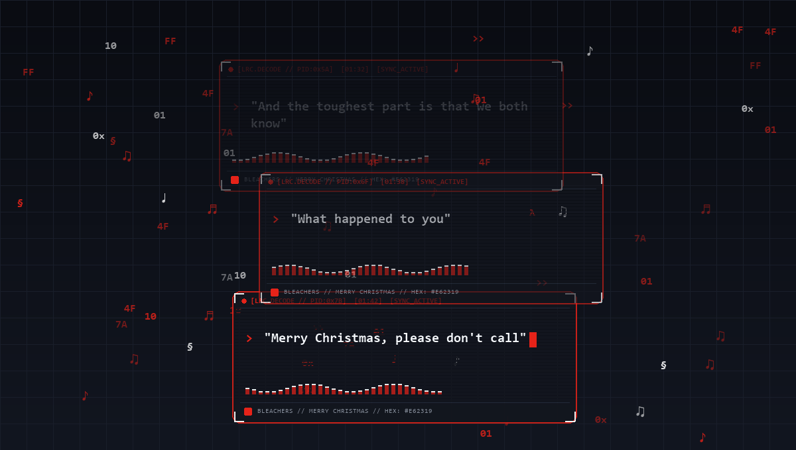

<div align="center">

# 🎵 Spotify Rising Hacker Lyrics Overlay

### *Real-Time Floating Lyrics HUD with Dynamic Album Cover Color Adaptation*

[](https://www.python.org/)
[](LICENSE)
[](https://microsoft.com/windows)
[](https://spotify.com)
[](#-zero-configuration-setup)

<br/>



<br/>

**A transparent, holographic tactical terminal overlay for Windows.**  
When playing music on Spotify, each lyric line spawns in its own separate tactical HUD card that floats gently upwards while swaying left and right. In the background, digital matrix streams (`01`, `10`, `0x`, `λ`, `§`) and musical notes (`♪`, `♫`, `♬`, `♩`) rain down, while the neon glow and card colors dynamically adapt to the album cover artwork!

</div>

---

## ⚡ Why It Stands Out

| Feature | Ordinary Lyrics Widgets | **Spotify Rising Hacker Overlay** |
|:---|:---:|:---:|
| **Card Movement** | Static or Bouncing DVD | **Floating Upwards & Swaying Left/Right** 🎈 |
| **Multi-Card Flow** | Only 1 line at a time | **Separate rising cards fading smoothly upwards** ✨ |
| **Color Theming** | Hardcoded Dark / Light | **Dynamic color extraction from active album cover** 🎨 |
| **Particle System** | None | **Digital Matrix Rain + Musical Glyphs** 🌧️ |
| **Audio Equalizer** | None | **Integrated 28-Bar Spectrum Visualizer** 📊 |
| **API Key Required**| Yes (Spotify Dev tokens) | **100% Zero API Keys Needed (Plug & Play)** 🔌 |
| **Sync Precision** | Often 2–3s delayed | **Zero-Delay Hardware Timestamp Extrapolation** ⚡ |
| **Desktop Overlay** | Standard Windowed | **100% Transparent Click-Through Overlay** 🖥️ |

---

## 🌟 Core Highlights

- **🎈 Rising Separate Cards**: Each lyric line is its own tactical terminal card that spawns at the bottom, rises gently upwards (`y -= speed`), and sways horizontally (`Δx = sin(...) * amp`), with older cards smoothly dissolving into the top.
- **⚡ Zero-Delay Precision Sync**: Eliminates Windows GSMTC timeline caching delay using microsecond `time.perf_counter()` hardware compensation.
- **🎨 Dynamic Album Cover Adaptation**: Quantizes colors from active album art to tint neon borders, equalizers, text accents, and matrix particles without sudden jarring color shifts (*smooth lerp crossfade*).
- **🌧️ Digital Matrix Rain**: Combines hex streams, binary bytes, and musical notes falling gracefully in the background.
- **⌨️ Live Calibration & Hotkeys**: Advance or delay lyrics live with `[` / `]` or arrow keys without restarting.
- **🖥️ Click-Through Mode**: Press `T` to let mouse clicks pass directly through to VS Code, browsers, or games behind the overlay.

---

## ⌨️ Controls & Hotkeys

All hotkeys work both inside the application window and globally across Windows:

| Hotkey | Global Shortcut | Action | Description |
|:---|:---|:---|:---|
| `↑` / `]` | `Ctrl+Shift+↑` | **Advance Lyrics (+0.10s)** | Calibrate lyrics to appear earlier if audio leads. |
| `↓` / `[` | `Ctrl+Shift+↓` | **Delay Lyrics (-0.10s)** | Calibrate lyrics to appear later if text leads. |
| `0` | - | **Reset Calibration** | Reset sync offset to default (+0.25s vocal anticipation). |
| `K` | `Ctrl+Shift+K` | **Toggle Karaoke Mode** | Switch between real-time synced lyrics and track metadata. |
| `T` | `Ctrl+Shift+T` | **Toggle Click-Through** | Enable click-through mode to interact with windows behind. |
| `F` | `Ctrl+Shift+F` | **Toggle Falling Stream** | Toggle digital matrix rain and musical note particles. |
| `G` | `Ctrl+Shift+G` | **Toggle CRT Scanlines** | Toggle subtle terminal monitor scanlines on cards. |
| `Space` | - | **Play / Pause** | Toggle Spotify playback. |
| `Right` / `N` | - | **Next Track** | Skip to next track on Spotify. |
| `Left` / `P` | - | **Previous Track** | Return to previous track. |
| `Esc` / `Q` | - | **Terminate Daemon** | Exit overlay cleanly. |

---

## 🚀 Quick Start

### 1. Clone & Install
```bash
git clone https://github.com/RobsHs/spotify-lyrics-overlay.git
cd spotify-lyrics-overlay
pip install -r requirements.txt
```

### 2. Launch
```bash
python song.py
```
*Play any song on Spotify, and your holographic lyrics overlay will immediately lock onto your music!*

---

## ⚙️ Architecture & Data Flow

```
┌──────────────────┐       Winsdk GSMTC       ┌──────────────────────┐
│  Spotify Desktop │ ───────────────────────► │ Windows Media Bridge │
└──────────────────┘                          └──────────┬───────────┘
                                                         │ Title + Artist + Art
                                                         ▼
┌──────────────────┐       LRCLIB API         ┌──────────────────────┐
│ Local Disk Cache │ ◄──────────────────────► │  Lyrics Fetch Engine │
└──────────────────┘                          └──────────┬───────────┘
                                                         │ Synced [mm:ss]
                                                         ▼
┌──────────────────┐    Pillow Quantization   ┌──────────────────────┐
│  Adaptive Colors │ ◄─────────────────────── │ Palette Lerp Engine  │
└──────────────────┘                          └──────────┬───────────┘
                                                         │ Tint Colors
                                                         ▼
┌──────────────────┐   Chroma-Key Win32 API   ┌──────────────────────┐
│ Windows Desktop  │ ◄─────────────────────── │ 60 FPS Pygame Engine │
│ Transparent HUD  │                          │ Rising Cards + Rain  │
└──────────────────┘                          └──────────────────────┘
```

---

## 🤝 Community & Sharing

Love this project? Share it with the community:

- **Reddit**: Post to [r/Python](https://reddit.com/r/Python), [r/unixporn](https://reddit.com/r/unixporn), or [r/spotify](https://reddit.com/r/spotify)!
- **Twitter / X**: Tag `#Python #Spotify #Cyberpunk #OpenSource` and mention `@RobsHs`!
- **GitHub**: Give a ⭐ Star to support development!

---

## 📄 License

Distributed under the [MIT License](LICENSE). Copyright © 2026 RobsHs.
